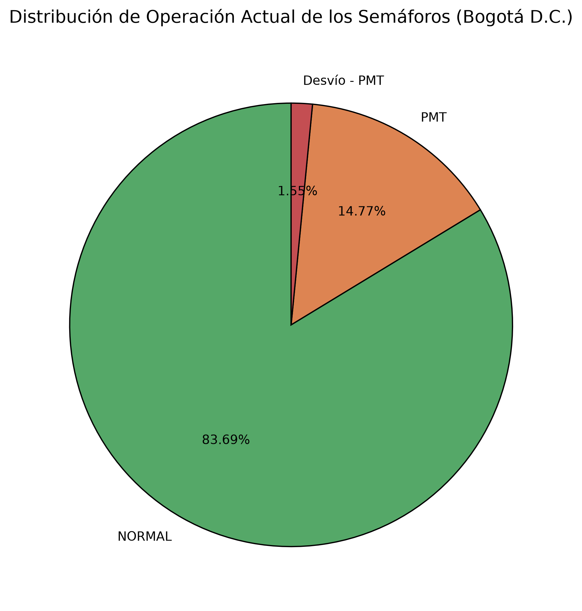
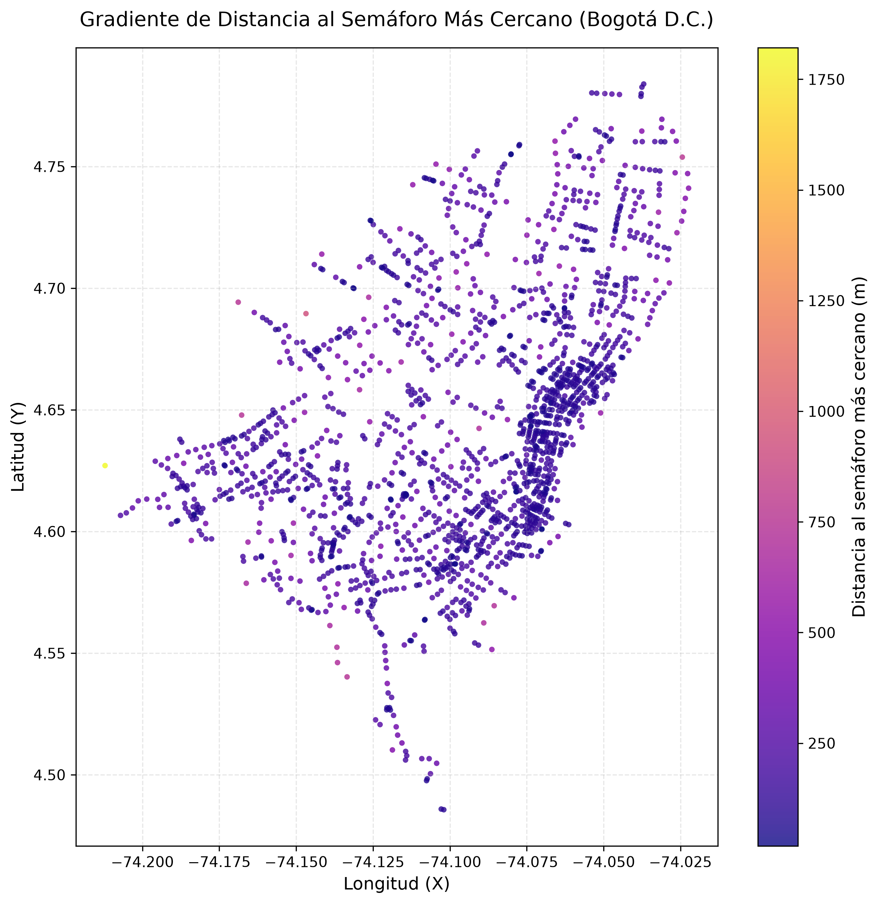
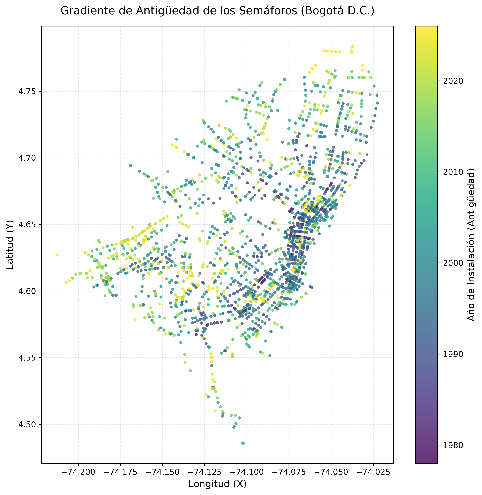
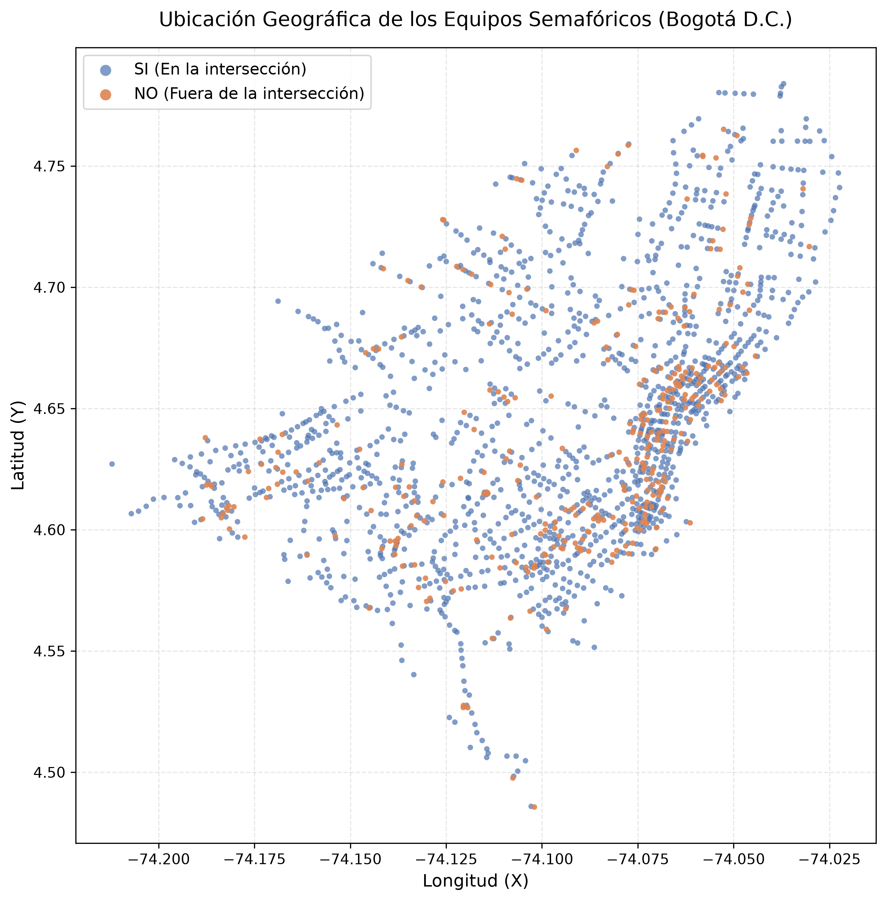

[English](README.md) | [Español](README.es.md)

# Análisis de la Red Semafórica de Bogotá D.C.

Análisis exploratorio y geoespacial de la infraestructura semafórica de Bogotá utilizando Python (Pandas, NumPy, Matplotlib) y SQLite.

## Información del Proyecto y Autor
* Diseñado por: Juan D. Monroy
* Fecha de inicio: 04/11/2026
* Fecha final: 7/11/2026
* Fuente de datos (CSV): Descargado el 04/11/2026 a las 18:55 (Bogotá, Colombia)
* URL de los datos: [Portal de Datos Abiertos de Movilidad Bogotá](https://datosabiertos-movilidadbogota.hub.arcgis.com/datasets/fccbfaa242374764a1fb8f746573cfad_0/explore?location=4.676091%2C-74.047004%2C12)

## Metodología y Notas Técnicas

* Este modo de manejo de datos es para obtener una aproximación y un análisis de la red semafórica de Bogotá.

* El flujo ideal para el manejo correcto de los datos debería ser: Esquema SQL -> Cargar datos crudos -> Limpiar -> Insertar en tabla final.

* Al no alterar la información original, no se trabajó con dicho flujo estricto. No hay pérdida de información (se validó el conteo de filas y columnas).

* Se muestra explícitamente la falta de Primary Key (PK) en este método a través del script `comprobacion_pk.py`. Esto ocurre porque la carga se realizó directamente desde Pandas (`to_sql`), el cual no infiere restricciones de unicidad.

## Hallazgos Principales

* Densidad de la red: La distancia promedio al semáforo más cercano es de ~193 metros, lo que refleja una red de alta densidad urbana.
* Estado de operación: El 83.7% de los semáforos operan en estado NORMAL, mientras que un 14.8% están bajo Planes de Manejo de Tráfico (PMT).
* Ubicación del equipo: El 81% de los equipos de control están ubicados directamente en la intersección (SI).

## Visualizaciones

### Diagrama de Torta - Estado de Operación

### Gradiente de Distancias
Muestra la densidad geográfica (oscuro = más cerca).

### Gradiente de Antigüedad
Muestra el año de instalación de los semáforos.

### Ubicación del Equipo

## Estructura del Repositorio
* `src/`: Scripts de Python (`cargar_datos.py`, `analisis_semaforos.py`, `comprobacion_pk.py`).
* `data/raw/`: Archivo original `.csv` y base de datos `semaforos.db`.
* `data/process/`: Resultados exportados (gráficos `.png` y reporte `.txt`).