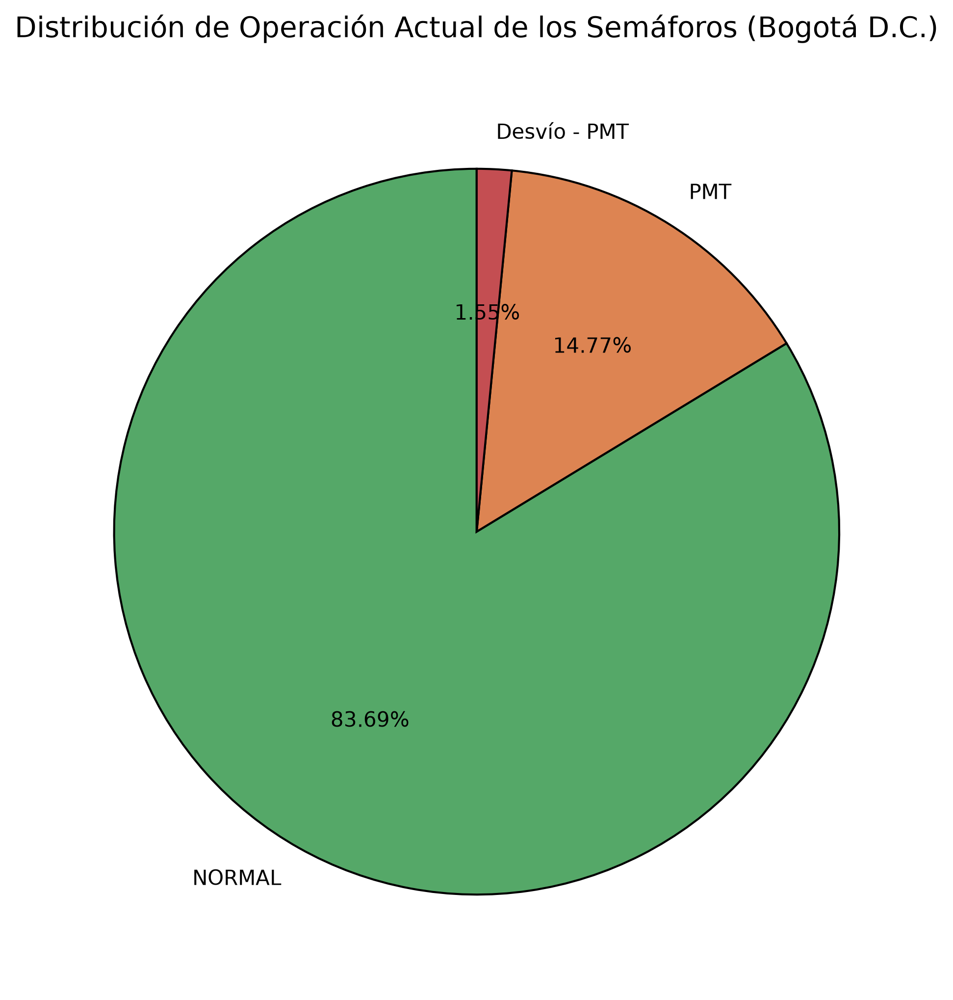
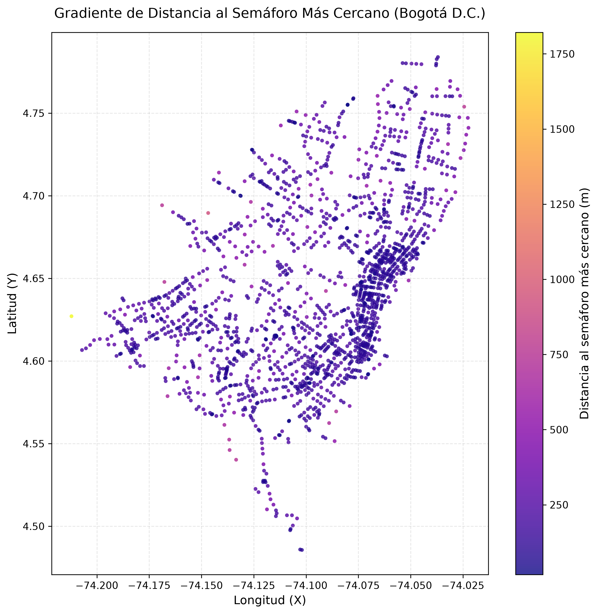
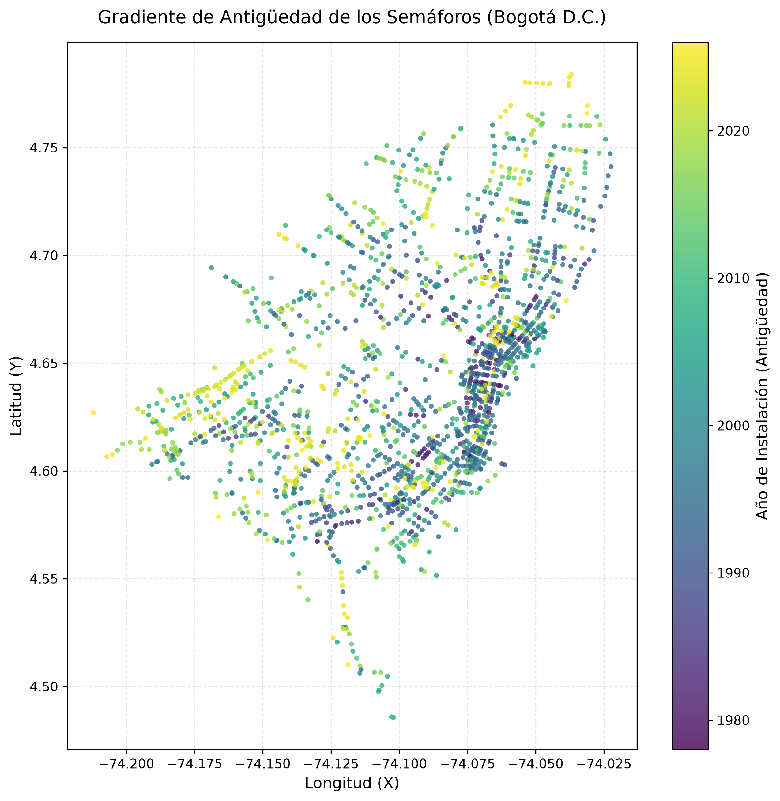
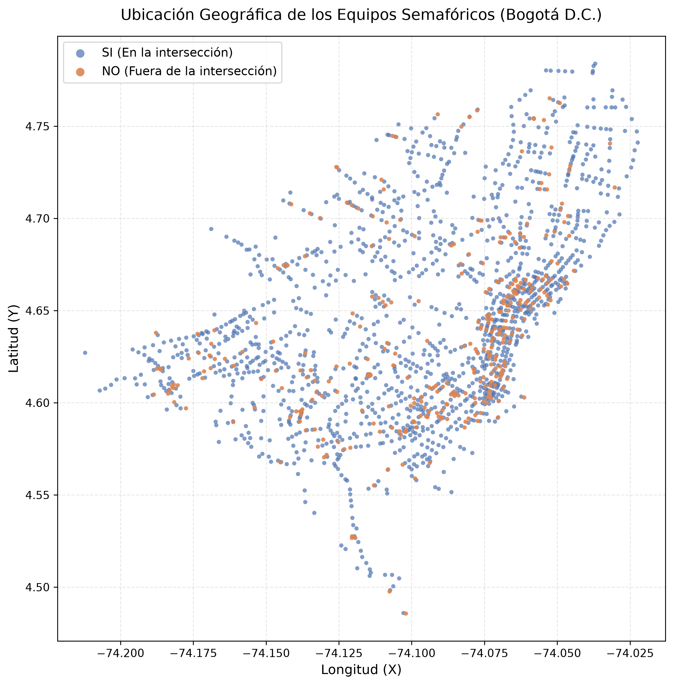

[English](README.md) | [Español](README.es.md)

# Analysis of the Traffic Light Network of Bogotá D.C.

Exploratory and geospatial analysis of Bogotá's traffic light infrastructure using Python (Pandas, NumPy, Matplotlib) and SQLite.

## Project Information and Author
* Designed by: Juan D. Monroy
* Start date: 04/11/2026
* End date: 7/11/2026
* Data source (CSV): Downloaded on 04/11/2026 at 18:55 (Bogotá, Colombia)
* Data URL: [Bogotá Open Data Portal - Mobility](https://datosabiertos-movilidadbogota.hub.arcgis.com/datasets/fccbfaa242374764a1fb8f746573cfad_0/explore?location=4.676091%2C-74.047004%2C12)

## Methodology and Technical Notes

* This data handling method is intended to provide an approximation and an analysis of Bogotá's traffic light network.

* The ideal data handling process should be: SQL schema -> load raw data -> clean -> insert into final table.

* Since the original information was not modified, that strict workflow was not applied. No information was lost (row and column counts were validated).

* The lack of a Primary Key (PK) in this method is explicitly shown by the `comprobacion_pk.py` script. This happens because the load was done directly from Pandas (`to_sql`), which does not infer uniqueness constraints.

## Key Findings

* Network density: The average distance to the nearest traffic light is ~193 meters, reflecting a high-density urban network.
* Operation status: 83.7% of traffic lights operate in NORMAL mode, while 14.8% are under Traffic Management Plans (PMT).
* Equipment location: 81% of the control equipment is located directly at the intersection (YES).

## Visualizations

### Operation Status Pie Chart

### Distance Gradient
Shows geographic density (darker = closer).

### Equipment Age Gradient
Shows the installation year of the traffic lights.

### Equipment Location

## Repository Structure
* `src/`: Python scripts (`cargar_datos.py`, `analisis_semaforos.py`, `comprobacion_pk.py`).
* `data/raw/`: Original `.csv` file and `semaforos.db` database.
* `data/process/`: Exported results (`.png` charts and `.txt` report).